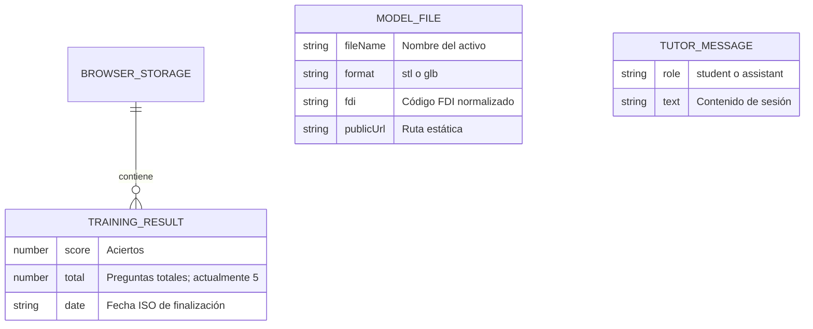

# Modelo de datos y persistencia

## Estado actual

Edudent-IA no tiene una base de datos relacional o documental. La información persistida por la aplicación son resultados de práctica en el `localStorage` del navegador. El catálogo de dientes se deriva de los nombres de archivos presentes en `public/models`; no es una tabla administrable. Las conversaciones con el tutor solo viven en el estado de la página.

`MODEL_FILE` y `TUTOR_MESSAGE` son conceptos en memoria o filesystem, no entidades de base de datos persistidas. La relación de almacenamiento solo aplica a `TRAINING_RESULT`.

## Resultado de práctica

| Campo | Tipo lógico | Regla observada |
| --- | --- | --- |
| `score` | número | Entero esperado entre 0 y `total`. El lector local descarta valores fuera de rango. |
| `total` | número | El lector acepta actualmente solo registros con total igual a 5. |
| `date` | cadena ISO | Se genera con `new Date().toISOString()` al completar. |

- Clave: `edudent-training-v1`.
- La aplicación conserva el tramo final de hasta 30 registros.
- El lector valida la forma básica de los valores, pero no autentica el origen del dato.
- El borrado de datos del sitio, uso de modo privado o cambio de navegador puede eliminar o aislar el historial.

## Catálogo de modelos

El endpoint lee los archivos del directorio `public/models` en cada consulta. Reconoce nombres `diente` con alias opcional `numero` y número de una o dos cifras, seguidos de `.stl` o `.glb`. Los alias 1–8 se normalizan a FDI 11–18. Si existen alias y un nombre FDI explícito, se prioriza el explícito. Para FDI 11 se usa el GLB incisivo central como valor por defecto.

## Propuesta futura (no implementada)

Si el curso exige persistencia multiusuario, habría que acordar requisitos de privacidad, cuentas, acceso, exportación, retención y despliegue antes de elegir un motor y diseñar entidades/migraciones. No se recomienda presentar como existente una base de datos que el repositorio no contiene.
