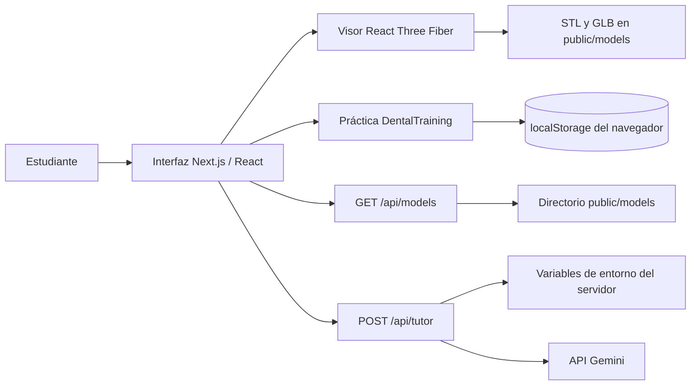
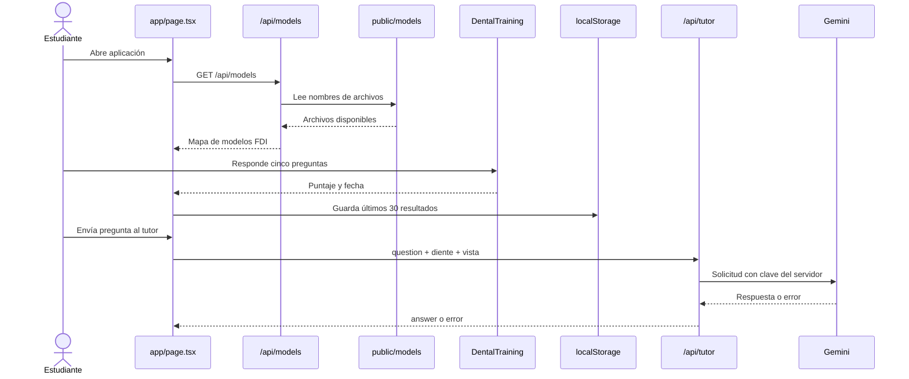

# Plan técnico

**Estado:** describe la arquitectura implementada; no propone migrarla.  
**Contexto:** aplicación existente (Brownfield).

## Arquitectura

La aplicación es un Next.js 14 con rutas App Router. La página de inicio es una interfaz cliente que mantiene el estado de selección y conecta paneles de navegación, visor y entrenamiento. Dos rutas del servidor proporcionan el catálogo y el proxy de Gemini. Los modelos 3D se sirven como activos estáticos. El navegador almacena localmente los resultados del cuestionario.

No hay base de datos, capa de autenticación ni backend de usuarios. `localStorage` es almacenamiento local del cliente, no una base de datos compartida. Los archivos del catálogo son recursos estáticos del despliegue y la ruta de modelos consulta sus nombres en el filesystem del servidor.

## Componentes

| Componente | Responsabilidad | Entradas/salidas principales |
| --- | --- | --- |
| `app/page.tsx` | Composición de la pantalla, navegación, selección de diente, importación local, estado de tutor y resultados. | Eventos UI; `GET /api/models`; `POST /api/tutor`; `localStorage`. |
| `components/DentalModelViewer.tsx` | Render Three.js, carga STL/GLB, cámara y controles de órbita; límite de error de carga. | URL/formato de modelo, vista, apertura, visibilidad, controles; lienzo WebGL. |
| `components/dentalGeometry.ts` | Transformación común de ambas arcadas y coloración ilustrativa por altura. | Geometrías STL; dos geometrías transformadas. |
| `components/DentalTraining.tsx` | Cinco preguntas, respuesta, explicación y cálculo de puntaje. | `onFocus` para guiar el visor; `onComplete` con puntaje y fecha. |
| `lib/toothModels.ts` | Descubrimiento y normalización del catálogo de modelos individuales. | Directorio de modelos; mapa FDI a URL y formato. |
| `app/api/models/route.ts` | Exposición dinámica y sin caché del catálogo. | `GET /api/models`; JSON o error 500. |
| `app/api/tutor/route.ts` | Validación básica, composición contextual y llamada a Gemini con timeout y modelos alternos. | `POST /api/tutor`; JSON `answer` o `error`. |
| `public/models/*` | Recursos estáticos: dos arcadas, incisivo GLB, diente 16 STL y logotipo. | Servidos por Next.js. |

## Interfaces internas y API

### Catálogo de modelos

`GET /api/models` no recibe parámetros. Devuelve un mapa indexado por código FDI, por ejemplo `{"16":{"url":"/models/Diente%20numero%206.stl","format":"stl"}}`. Se excluyen archivos que no coinciden con el patrón de nombres o con formatos STL/GLB. La ruta es dinámica y envía `Cache-Control: no-store`.

### Tutor educativo

`POST /api/tutor` recibe `{ "question": string, "tooth"?: string, "activeView"?: string }`. La ruta exige un objeto JSON, recorta espacios, rechaza preguntas vacías y limita la pregunta a 1200 caracteres; el contexto se limita a 120 caracteres para el diente y 80 para la vista. Las entradas inválidas responden HTTP 400. La respuesta exitosa contiene `{ "answer": string }`. Los errores comunicados contienen `{ "error": string }`, incluidos clave ausente o error del proveedor. La clave se envía a Gemini desde el servidor en el encabezado `x-goog-api-key`; no forma parte de la respuesta al cliente. El cliente conserva el intercambio solo en memoria durante la sesión.

### Contratos de componentes

- El visor acepta `modelUrl`, `modelFormat`, `activeView`, `toolMode`, `opening`, `visibility`, `autoRotate` e `isolatedTooth`; expone `resetCamera()` con una ref.
- El entrenamiento recibe `onFocus(arch, view)` y `onComplete({ score, total, date })`.
- `localStorage` usa `edudent-training-v1` y serializa un arreglo de resultados `{ score, total, date }`.

## Flujo de datos

## Manejo de fallos y límites

- Error al cargar una geometría: el límite de error del visor muestra un mensaje y registra el detalle en consola.
- Error de catálogo: la ruta responde 500; la interfaz conserva un mensaje de catálogo no disponible.
- Error del tutor: la interfaz conserva un mensaje contextual; en servidor hay timeout de 30 segundos y fallback de modelos.
- Fallo de escritura de `localStorage`: la sesión sigue en memoria y se presenta un aviso.
- El tamaño de modelos locales afecta memoria y rendimiento del navegador; no existe validación semántica ni sanitización del contenido geométrico.

## Verificación del plan

El diagrama y las responsabilidades corresponden a rutas y componentes del repositorio. No se agrega PostgreSQL, ORM, Docker, autenticación ni API de persistencia porque no forman parte de la arquitectura vigente ni son necesarios para los requisitos implementados.
